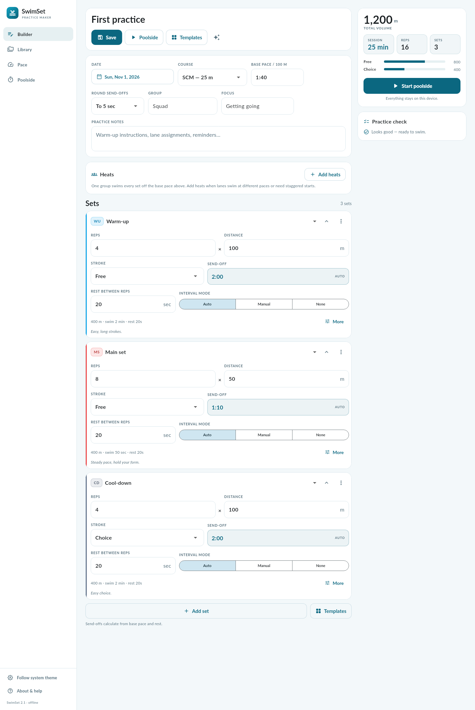
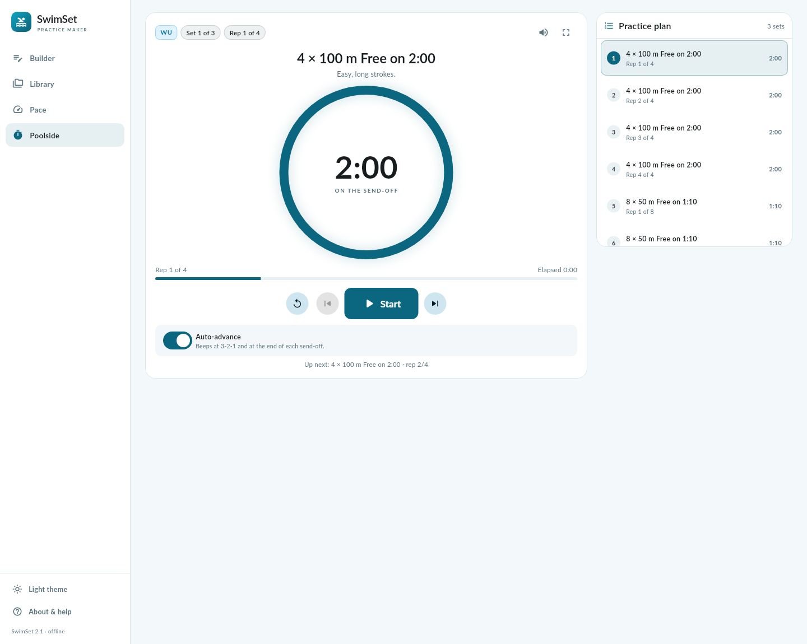
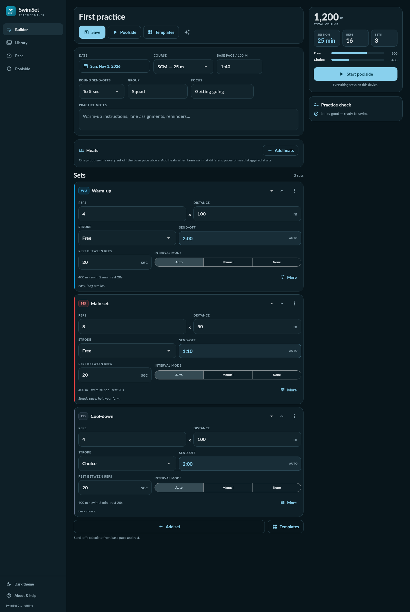
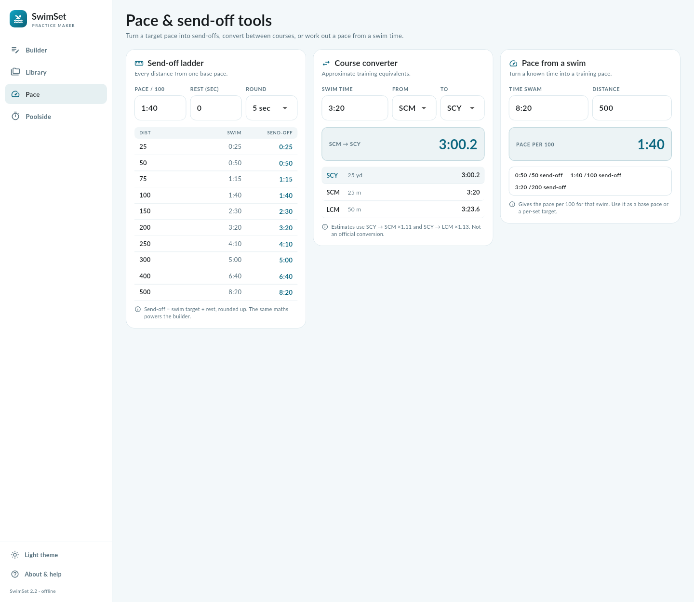
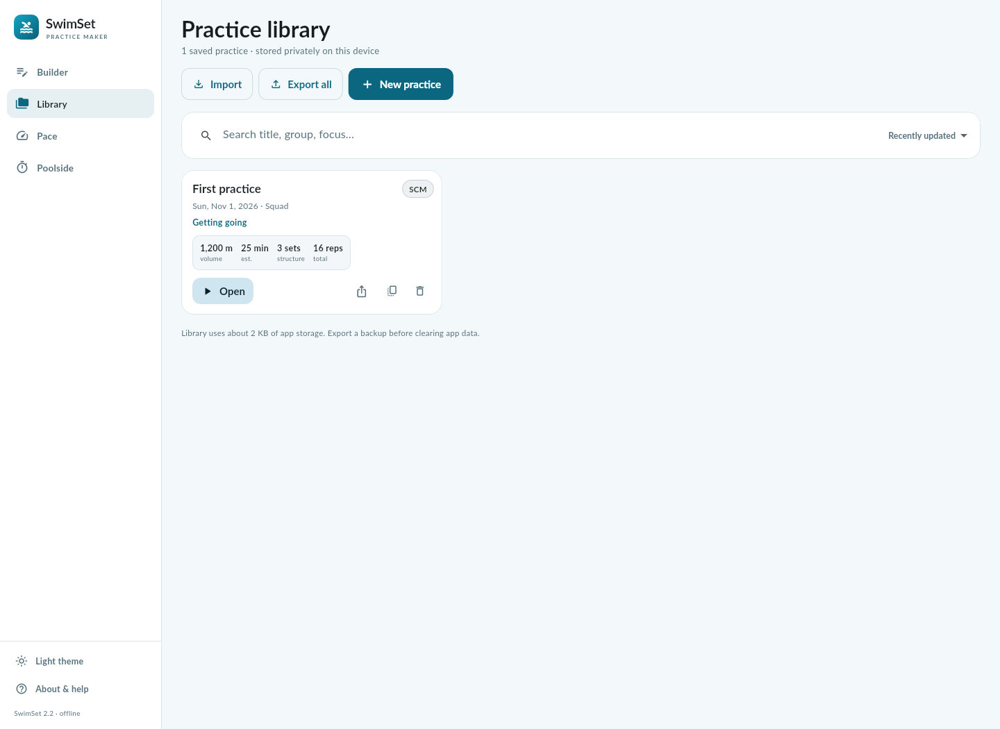
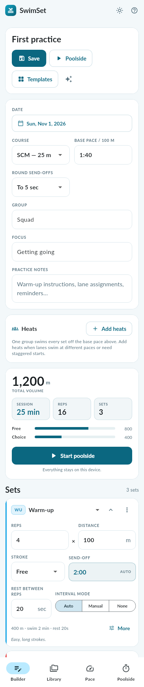

# SwimSet

**A native swim practice maker for Debian, Android and Chromebooks.**

SwimSet turns a base pace into a whole practice: build the session set by set, let
it calculate send-offs, print a deck sheet, then run it poolside with a rep-by-rep
timer. It is a native app — one Dart/Flutter codebase compiled to a real Android APK
and a real GTK Linux binary. No WebView, no browser window, no accounts and no
network calls.

- **Native on both targets.** Android/ChromeOS gets an APK; Debian (and the Linux
  container on Intel/AMD Chromebooks) gets a `.deb` with a GTK 3 executable.
- **Offline by design.** The release APK does not even request the `INTERNET`
  permission. Practices live in app storage on the device.
- **Built by CI.** GitHub Actions compiles both binaries and commits them, together
  with the test logs and UI screenshots, back to the branch.

| Builder | Poolside timer | Dark theme |
| --- | --- | --- |
|  |  |  |

| Pace tools | Library | Phone layout |
| --- | --- | --- |
|  |  |  |

Screenshots are rendered from the real Flutter widget tree by the CI screenshot test
(`make screens`), at desktop and phone sizes.

## Features

**Practice builder**
- Twelve set types with colour accents: warm-up, pre-set, drill, kick, pull, main,
  sprint, IM, recovery, test, cool-down and choice.
- Reps × distance, stroke, equipment, target pace, rest and notes per set.
- Automatic send-offs: target swim time + rest, rounded up to 1/5/10 seconds.
  Override with a custom send-off or mark a set as a continuous swim.
- Courses SCY (25 yd), SCM (25 m) and LCM (50 m), including the send-off maths.
- Live totals: volume, estimated session time, reps, sets and volume by stroke.
- A *practice check* that flags missing warm-ups/cool-downs and send-offs shorter
  than the target swim time.
- **Heats.** Add up to eight heats with their own names and base paces. Every set
  shows a send-off per heat, totals show each heat's session time, and the deck
  sheet prints the heat send-offs under each set.

**Pace tools**
- Send-off ladder for 25 → 500 at any base pace and rest.
- Approximate course converter (SCY ↔ SCM ↔ LCM, ×1.11 and ×1.13).
- “Pace from a swim” to turn a known time into a pace per 100.

**Poolside runner**
- Rep-by-rep timer with a progress ring, overall progress and elapsed time.
- Beeps at 3-2-1 and at the end of each send-off, muted with one tap.
- **Multiple heats on one clock.** Set a start interval and the runner staggers the
  heats, showing each heat's countdown, a send cue when the next heat goes off the
  wall, and a tap-to-follow heat strip.
- Auto-advance, previous/next/jump (single timeline), fullscreen and a screen that
  stays awake while the timer runs (handled by the Android window flags, not a
  background service).
- Big touch targets sized for a phone propped up at the end of a lane.

**Library and sharing**
- Save, search, sort, duplicate and delete practices.
- Autosaved working draft, so closing the app never loses the session.
- Import/export JSON (one practice or the whole library), plain-text sheets and
  print-ready PDF deck sheets with tick boxes.
- Light, dark and follow-system themes; responsive phone, tablet, Chromebook and
  desktop layouts.

## Install

### Debian, and Chromebooks with the Linux container

Download `swimset_2.0.0_amd64.deb` from the [latest release][release] (or from
`ci-artifacts/` in this repository) and install it:

```bash
sudo apt install ./swimset_2.0.0_amd64.deb
```

Then launch **SwimSet** from the applications menu, or run `swimset`. The package
installs the bundle to `/opt/swimset`, a launcher in `/usr/bin`, and a desktop entry
and icon under `/usr/share`. Runtime dependencies: GTK 3, GLib, libstdc++ and the
GStreamer base libraries (used for the countdown beeps).

On a Chromebook: enable **Settings → Linux development environment**, then open the
`.deb` from the Files app or run the command above in the Linux terminal. On
Chromebooks that run Android apps you can install the APK instead.

### Android and ChromeOS (Android apps)

Download `swimset-2.0.0-universal.apk` from the [latest release][release] and open
it on the device (allow installing from your file manager when prompted), or use adb:

```bash
adb install swimset-2.0.0-universal.apk
```

- Android 6.0+ (`minSdk 23`); the universal APK contains `arm64-v8a`,
  `armeabi-v7a` and `x86_64` code for phones, tablets and Chromebooks.
- CI signs the APK with the debug key, so it is meant for sideloading and personal
  use, not the Play Store. Build locally with your own keystore if you need that.

### Build it yourself

Requires Flutter 3.24+ with the Android SDK (platform 35, JDK 17) and, for Linux,
`clang cmake ninja-build pkg-config libgtk-3-dev libgstreamer1.0-dev
libgstreamer-plugins-base1.0-dev`.

```bash
make apk         # native/build/app/outputs/flutter-apk/app-release.apk
make deb         # native/build/deb/swimset_2.0.0_amd64.deb
make test-native # 24 Flutter unit/widget tests
```

The supported builder is CI. `.github/workflows/native.yml` runs on every push:

1. install JDK 17, Flutter 3.24.5 and the Linux desktop toolchain;
2. `flutter pub get` + `flutter analyze` + unit/widget tests;
3. render the UI screenshots (and fail on any layout overflow);
4. build the release APK and the Linux bundle;
5. package the `.deb`, upload both binaries with the workflow artifact, and — when
   the commit message contains `[ship]` — refresh the GitHub release and commit the
   binaries, logs and screenshots to `ci-artifacts/`.

Every run's `swimset-native` artifact contains `swimset-2.0.0-universal.apk` and
`swimset_2.0.0_amd64.deb`, so no build ever ends without downloadable binaries.

[release]: https://github.com/mob5824m-wq/SwimSet/releases/latest

## How the maths works

- **Send-off** = round up to the practice step of `distance ÷ 100 × pace + rest`.
  A 4×100 free at 1:40 with 20 s rest becomes a 2:00 send-off; 8×50 at 1:40 with
  20 s rest becomes 1:10.
- **Continuous sets** (`none`) run for `reps × swim + (reps − 1) × rest`.
- **Manual send-offs** are used as typed; a set-specific pace overrides the base pace.
- **Heats** reuse the same sets but their own base pace, so a 1:50 heat gets
  longer send-offs than a 1:40 heat. The poolside clock offsets heat *n* by
  `n × interval`, so heat 2 is sent from the same clock as heat 1.
- **Course conversion** uses SCY → SCM ×1.11 and SCM → LCM ×1.13 (approximations,
  labelled as such in the UI).

## Data and privacy

- Practices are stored as JSON in the platform’s preferences store
  (`swimset.v2.practices`, `swimset.v2.draft`, `swimset.v2.theme`); the library
  screen reports how much space it uses.
- Export produces a JSON file (`{app, version, exportedAt, practices}`) that the
  import screen accepts in three shapes: one practice, a list, or that object.
- There is no server, no account, no analytics and no HTTP client in the app. PDFs
  and text sheets are generated on the device.

## Repository layout

```
native/                the native app (Flutter, Dart)
  lib/main.dart        app entry: store, state, MaterialApp
  lib/src/models.dart  practice/set models, send-off maths, formatting, validation
  lib/src/templates.dart  seven built-in practices
  lib/src/store.dart   local persistence and JSON import/export
  lib/src/state.dart   AppState (draft, library, theme, tabs)
  lib/src/export.dart  PDF deck sheets, file save/open, text helpers
  lib/src/ui/          builder, library, pace, poolside, shell and shared widgets
  test/                models, store, widget and screenshot tests
  tool/package_deb.sh  builds the Debian package from the Linux bundle
  android/, linux/     native runners for the two targets
.github/workflows/native.yml  CI that builds and publishes both binaries
index.html, js/, css/  legacy web build, kept as the reference implementation
tests/                 test suite for the legacy web build
```

## Legacy web build

The original offline-first PWA is still in the repository (`index.html`, `js/`,
`css/`, `sw.js`) and remains the readable reference for the practice maths and the
visual design. It is not what ships: `make serve` runs it, `make test` runs its
logic tests, and the native app reimplements it in Dart.

## Credits and licence

MIT licensed (see `LICENSE`). Bundled typeface: [Lato](https://www.lato-fonts.com/),
SIL Open Font License. Icons: Material Icons, Apache License 2.0.
